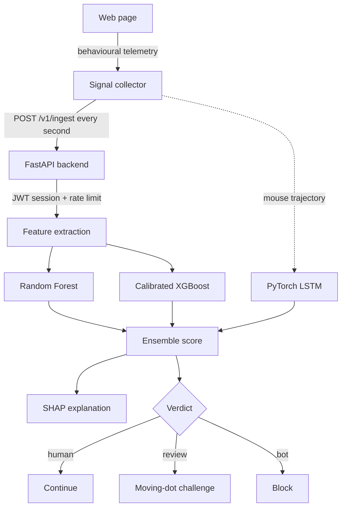

<div align="center">

# 🛡️ PassiveCaptcha

**Invisible, machine-learning human verification: no crosswalks, no fire hydrants, no blurry text.**

PassiveCaptcha watches *how* someone uses a page (mouse dynamics, scrolling, typing rhythm, browser signals) and decides whether they're human, without asking them to solve anything.

[](LICENSE)
[](https://fastapi.tiangolo.com)
[](https://pytorch.org)
[](https://xgboost.ai)
[](https://react.dev)
[](CONTRIBUTING.md)

[How it works](#how-it-works) · [Quick start](#quick-start) · [Models](#models) · [API](#api) · [Roadmap](#roadmap) · [Contributing](#contributing)

</div>

---

> **Status: research prototype.** The ML pipeline, dashboard and fallback challenge work end to end locally. It is **not yet hardened for production**; see [Security notes](#security-notes) and the [roadmap](#roadmap). Contributions that move it toward production are very welcome.

## The problem

Traditional CAPTCHAs make every user prove they're human: they add friction, hurt sign-up conversion and are increasingly solved by vision models and click farms anyway.

## The idea

Most humans can be recognised **passively**. PassiveCaptcha collects privacy-preserving behavioural signals in the background and scores each session:

| Score (P(human)) | Verdict | What the user sees |
| --- | --- | --- |
| ≥ 0.75 | ✅ Human | Nothing. They just continue. |
| Between | 🤔 Review | A one-click "catch the moving dot" challenge |
| Below the review threshold | 🚫 Bot | Blocked |

Thresholds are calibrated per model at training time; the defaults are shown above.

## How it works



**Signals collected (behavioural and device signals, no account data):**

- **Pointer:** speed, acceleration, jerk, path linearity, clicks
- **Scroll:** velocity, variance, direction changes
- **Keyboard:** event counts, inter-key timing and hold duration. Only timing is used for scoring; see Security notes about key values.
- **Environment:** device pixel ratio, viewport anomalies, touch points, WebGL renderer, canvas hash
- **Timing:** time to first interaction, tab-visibility changes

The full feature list is in [`backend/train/signal_schema.json`](backend/train/signal_schema.json).

**Explainable verdicts.** Every score comes with SHAP feature contributions, and the built-in dashboard shows *why* a session looked human or bot-like.

## Quick start

You need Python 3.12+ and Node.js 20+.

```bash
git clone https://github.com/skdas20/PassiveCaptcha.git
cd PassiveCaptcha
```

**1. Start the API** (port 8000):

```bash
cd backend
pip install -r requirements-api.txt
python -m uvicorn app.main:app --reload --host 127.0.0.1 --port 8000
```

**2. Start the web app** (port 5173), in a second terminal:

```bash
cd apps/web
npm install
npm run dev
```

**3. Try it.** Open <http://localhost:5173>, move and scroll naturally and watch the dashboard classify you. Then behave like a script (perfectly straight lines, no scrolling) to trigger the fallback challenge.

**Or use Docker:**

```bash
docker compose up --build
```

> Without trained model files, the API falls back to a hand-tuned heuristic score so you can explore the UI immediately. Train the models (below) for real ML verdicts.

## Models

| Model | Input | Trained by | Artifact |
| --- | --- | --- | --- |
| Random Forest | Tabular session features | `train/train_baseline.py` | `baseline_model.joblib` |
| Calibrated XGBoost | Tabular session features | `train/train_xgboost.py` | `xgboost_calibrated_model.joblib` |
| LSTM | Raw mouse-trajectory sequence | `train/train_lstm.py` | `lstm_mouse_model.pt` (included) |

Train from the repository's `backend/` folder:

```bash
pip install -r requirements-ml.txt

# Tabular models: train/data/sessions.csv is already included
python -m train.train_baseline
python -m train.train_xgboost

# LSTM (and regenerating sessions.csv) needs the raw dataset unpacked first
unzip train/raw/web_bot_detection_dataset.zip -d train/raw/web_bot_detection_dataset
python -m train.import_bordar      # rebuilds train/data/sessions.csv
python -m train.train_lstm
```

Artifacts are written to `backend/train/artifacts/` and picked up automatically on the next API start. Training data comes from a public web-bot mouse-movement dataset (`backend/train/raw/`); it has no scroll, keyboard or browser signals, so those features are zero-filled during training.

## API

| Method | Endpoint | Purpose |
| --- | --- | --- |
| `GET` | `/health` | Liveness check |
| `POST` | `/v1/init` | Start a session; returns a JWT |
| `POST` | `/v1/ingest` | Send telemetry (`Authorization: Bearer <token>`); returns scores, verdict and SHAP values |
| `POST` | `/v1/login` | Dashboard login |

Interactive docs: <http://localhost:8000/docs> (FastAPI/OpenAPI).

## Project structure

```
apps/web/            React 19 + Vite + Tailwind demo, dashboard and fallback challenge
  src/lib/signalCollector.ts   behavioural signal collection
  sdk.js             drop-in SDK (early stub)
backend/
  app/               FastAPI service: auth, feature extraction, scoring, SHAP
  train/             dataset import and training scripts for all three models
docker-compose.yml   API + web app
```

## Security notes

This is a prototype. Before any real deployment:

- Stop sending key values: the collector currently includes `event.key` in keyboard samples. The backend only uses timing, so the value can simply be dropped.
- Set your own JWT signing key: the current one is hard-coded in `backend/app/main.py`.
- Change the default dashboard credentials, and replace unsalted SHA-256 password hashing with Argon2 or bcrypt.
- Restrict CORS (currently `*`).
- Move sessions and rate limiting from the in-memory store to Redis so they survive restarts and scale across workers.

Each item is tracked as an issue; pick one up!

## Roadmap

- [ ] Publish the signal collector as a real drop-in npm/script-tag SDK
- [ ] Configuration via environment variables (secret key, CORS, thresholds)
- [ ] Redis-backed sessions and sliding-window rate limiting
- [ ] Unit tests for feature extraction and scoring, plus CI
- [ ] Collect a richer dataset with scroll, keyboard and environment signals
- [ ] Accessibility review of the fallback challenge (keyboard and screen readers)
- [ ] Benchmarks against common automation (Playwright, Puppeteer, Selenium)

## Contributing

Machine learning, frontend, backend and security contributions are all welcome. Start with a [`good first issue`](https://github.com/skdas20/PassiveCaptcha/labels/good%20first%20issue) and read [CONTRIBUTING.md](CONTRIBUTING.md).

If you find the idea interesting, **a ⭐ helps others discover it**.

## Authors

Built by [Sumit Kumar Das](https://github.com/skdas20) and [Piyush Yadav](https://github.com/piyushrajyadav).

## License

[MIT](LICENSE)
